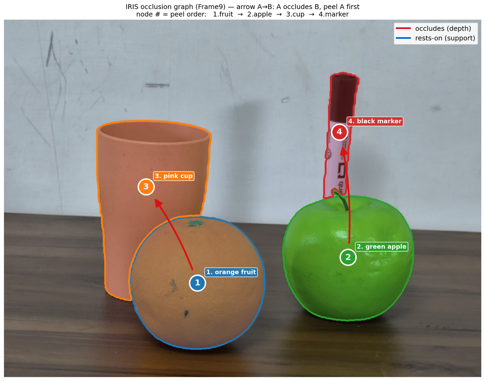
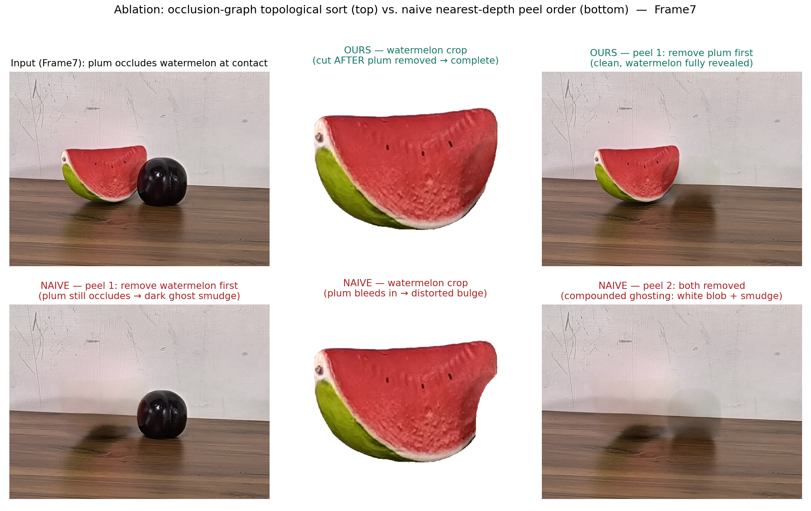
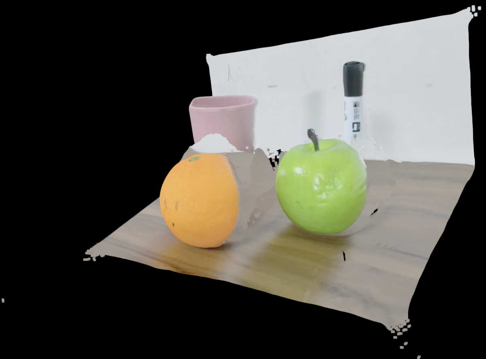

# IRIS — Iterative Reconstruction via Incremental Scene-peeling

**Occlusion-aware 3D scene reconstruction from a single RGB image.**

A single view only shows the front-most surface of a scene. Everything behind it is
a blind spot, and most reconstruction pipelines silently collapse that blind spot
into empty space. IRIS instead exploits one geometric guarantee — *the nearest
object cannot itself be occluded* — and peels the scene apart one object at a time.

Each iteration segments the front-most object, reconstructs it in 3D, then **erases
it from the image** so that whatever it was hiding becomes visible to the next
iteration. Because the camera never moves, the peeled images form a stack of
*same-pose synthetic views* that a multi-view reconstructor can fuse into a single
scene. Volume that is never observed is reported explicitly as **occluded /
unknown**, rather than as free space.

IRIS is **training-free**. It composes open-weight models; no component is
fine-tuned, and there are no runtime API calls.



*The occlusion graph IRIS builds for one scene. An arrow A→B means A occludes B and
must be peeled first; the node numbers are the resulting order. Edges come from
comparing depth in the contact band where two masks meet, with a physical-support
tie-break when depth is inconclusive.*

```
RGB image
   └─ object discovery (Qwen3-VL)
   └─ peel loop, front-to-back:
        ├─ segment front object          (SAM 3)
        ├─ order by occlusion graph      (Depth-Anything-V2 + topological sort)
        ├─ reconstruct object in 3D      (Amodal3R, or TRELLIS)
        └─ erase object from image       (RORem / SDXL-inpainting)
   └─ scene reconstruction over the peeled view stack   (VGGT)
   └─ gravity-aligned registration + fusion
   └─ surface reconstruction             (NKSR, or screened Poisson)
   └─ instance-aware semantic labelling  (Mask2Former)
   └─ free / occupied / occluded occupancy grid
```

### Why the peel order matters

Peeling is only sound if an occluder is removed *before* whatever it hides. Get that
wrong and the inpainter paints over geometry that is still covered, and the crop
handed to image-to-3D is contaminated:



*Top: the occlusion graph peels the plum first, so the watermelon crop is complete.
Bottom: a naive nearest-depth sort peels the watermelon first while the plum still
occludes it — the crop bleeds into a distorted bulge and the removal leaves a ghost.*

This is why ordering is a pairwise question decided at contact, not a global depth
sort. The naive baseline above is reproducible with `IRIS_PEEL_ORDER=naive`.

Full technical breakdown: [docs/architecture.md](docs/architecture.md).

---

## Contents

- [Requirements](#requirements)
- [Installation](#installation)
- [Quickstart](#quickstart)
- [Usage](#usage)
- [Outputs](#outputs)
- [Reproducing the benchmarks](#reproducing-the-benchmarks)
- [Configuration](#configuration)
- [Repository layout](#repository-layout)
- [Models](#models)
- [License](#license)

---

## Requirements

- Linux, NVIDIA GPU, CUDA 12.1 driver or newer
- [conda](https://docs.conda.io/) (miniconda or equivalent)
- **VRAM.** The default 32B discovery VLM is the peak; it expects an 80 GB card
  (H100 class). On smaller GPUs pass `--vlm Qwen/Qwen3-VL-8B-Instruct` (~16 GB in
  bf16, comfortable on 24 GB). Every other stage fits well under 24 GB, and stages
  run sequentially so only one heavy model is resident at a time.
- **Disk.** ~60 GB for model weights and conda environments.
- A Hugging Face account with an `HF_TOKEN`: SAM 3 (`facebook/sam3`) is a gated
  repository and will not download without one.

## Installation

IRIS uses several conda environments because the image-to-3D backends and the
surface reconstructor need mutually incompatible CUDA/PyTorch stacks. They are
driven as subprocess workers, so the main environment stays clean.

| Environment | Purpose | Key pins |
|---|---|---|
| `iris` | main pipeline: VLM, SAM 3, depth, RORem, VGGT, Mask2Former, occupancy | torch 2.5.1+cu121, transformers 5.9, diffusers 0.38 |
| `amodal3r` | occlusion-aware image-to-3D (**default** backend) | torch 2.4.0+cu118, spconv-cu118, xformers 0.0.27 |
| `trellis` | image-to-3D baseline backend | torch 2.4.1+cu118, spconv-cu118, xformers 0.0.28 |
| `nksr` | neural kernel surface reconstruction (optional, see below) | torch 2.7.0+cu128, CUDA extension built from source |

```bash
git clone https://github.com/sparshj42/IRIS_plus.git && cd IRIS_plus

# 1. environments + third-party model repos
bash scripts/setup_envs.sh                  # all of the above
# or select: bash scripts/setup_envs.sh iris amodal3r

# 2. weights that are not auto-downloaded (RORem)
conda run -n iris python scripts/fetch_weights.py

# 3. authenticate for the gated SAM 3 weights
export HF_TOKEN=hf_...

# 4. verify
conda run -n iris python src/pipeline.py --image data/demoImage.png \
    --output_dir output/smoke --vlm Qwen/Qwen3-VL-8B-Instruct
```

Everything else (Qwen3-VL, SAM 3, Depth-Anything-V2, SDXL-inpainting, Amodal3R,
TRELLIS, VGGT, Mask2Former) downloads from Hugging Face on first use.

**On the `nksr` environment.** NKSR produces smoother, watertight object meshes and
is what the pipeline uses by default when it is present. Building it compiles a CUDA
extension and requires `nvcc` matching your driver (CUDA 12.8 by default; override
with `CUDA_HOME`). **It is optional** — if the environment is absent, the pipeline
automatically falls back to screened Poisson reconstruction and prints which path it
took. Results differ between the two, so state which was used when reporting numbers.

Detailed notes and troubleshooting: [docs/installation.md](docs/installation.md).
Flag-by-flag reference: [docs/user_guide.md](docs/user_guide.md).

## Quickstart

```bash
conda run -n iris python src/pipeline.py \
    --image data/frames_small/Frame3.jpg \
    --output_dir output/frame3
```

With a metric depth map (RGB-D input), which fixes the reconstruction to real scale:

```bash
conda run -n iris python src/pipeline.py \
    --image  path/to/frame.jpg \
    --depth  path/to/depth.npy \
    --output_dir output/rgbd
```

## Usage

| Flag | Default | Description |
|---|---|---|
| `--image` | `data/demoImage.png` | Input RGB image |
| `--output_dir` | `output` | Where artefacts are written |
| `--depth` | – | Metric depth map (`.npy`, metres) for RGB-D input; gives metric scale |
| `--sparse_depth` | – | Sparse depth measurements instead of a dense map |
| `--scene_dir` | – | Directory of frames for multi-frame input |
| `--image3d` | `amodal3r` | Per-object image-to-3D backend: `amodal3r` or `trellis` |
| `--vlm` | `Qwen/Qwen3-VL-32B-Instruct` | Discovery VLM; use the 8B id on smaller GPUs |
| `--skip_3d` | off | Skip per-object image-to-3D (observed surface only; much faster) |
| `--stop_after_peeling` | off | Stop after the peel loop, before reconstruction |
| `--resume` | off | Resume an interrupted run from per-object checkpoints |

`--resume` is worth knowing about: the peel loop checkpoints after every object, so
an interrupted run costs one object rather than the whole scene.

## Outputs

Written to `--output_dir`:

| File | Contents |
|---|---|
| `final_mesh.ply` | Fused scene mesh (objects + background) |
| `objects_mesh.ply`, `objects_nksr.ply` | Object geometry (Poisson / NKSR path) |
| `background_nksr.ply` | Background surface |
| `observed_pointcloud.npy` | Directly observed surface, gravity-aligned |
| `completion_pointcloud.npy` | Amodal completions for occluded geometry |
| `scene_pointcloud.npy` | Raw VGGT scene cloud, camera frame |
| `vggt_pointmaps.npz` | VGGT point maps, per-view intrinsics and extrinsics |
| `object_records.pkl` | Per-object label, instance mask, and point cloud |
| `occupancy_grid.npy` | Free / occupied / occluded voxel grid |
| `synthetic_views/` | The peeled same-pose view stack |
| `object_crops/` | De-occluded crops fed to image-to-3D |

Two of those outputs are worth showing directly. The occupancy grid separates space
the camera actually saw from space it could not, instead of treating unseen volume as
empty:


*Orthogonal slices through the occupancy grid. Volume hidden behind a surface is
labelled occluded, not free.*

And the fused scene can be viewed from angles the camera never occupied:



*The fused reconstruction rendered from an off-axis viewpoint. The input was a
single frontal photograph.*

## Reproducing the benchmarks

Evaluation is against ScanNet, using a **prediction-independent** protocol: the
ground-truth regions are defined by GT geometry and the input camera alone, never by
distance to the prediction.

```bash
# 1. prepare one ScanNet scene (extracts a frame + its depth, intrinsics, pose)
conda run -n iris python scripts/prep_gt.py \
    <scene>.sens <frames_out_dir> <gt_out_dir>

# 2. run IRIS on that frame
conda run -n iris python src/pipeline.py \
    --image <frames_out_dir>/frame_XXXXXX.jpg \
    --depth <gt_out_dir>/depth.npy \
    --output_dir output/<scene>

# 3. score
conda run -n iris python scripts/benchmark_scannet.py \
    output/<scene> <scannet_scene_dir> <gt_out_dir> 0.05
```

The scorer reports, separately:

- **Visible F1** — observed surface against the GT surface visible from the input
  camera. Measures reconstruction quality.
- **Occluded recall** — amodal completions against GT surface that lies *behind* the
  visible depth in the input view. Measures occlusion recovery, which is the claim
  the visible-region score deliberately does not credit.

Two things to be careful about when reproducing:

- `prep_gt.py` writes depth, intrinsics and pose for **one specific frame**. If a
  frames directory contains several images, pairing the wrong one with that GT
  silently degrades the score rather than failing. Match them explicitly.
- `scripts/benchmark_scannet_det.py` is the same scorer with the RANSAC in the
  occluded-recall path seeded, so repeated scoring of identical artefacts returns
  identical numbers. Use it when comparing runs.

A peel-ordering ablation is built in: setting `IRIS_PEEL_ORDER=naive` replaces the
occlusion graph with a plain nearest-pixel depth sort — the baseline the ordering is
meant to improve on. Leave it unset for the default ordering.


**Reproducibility caveat.** The pipeline is not bit-deterministic. Peel order,
object discovery and the VGGT scene cloud reproduce exactly, but the estimated
gravity frame varies slightly between runs (unseeded RANSAC plane fit) and the
generative image-to-3D backends vary in point count. Measured run-to-run spread on a
fixed scene: visible F1 ±0.001, occluded recall ±0.007. Differences smaller than
that are noise.

## Configuration

All optional; defaults resolve relative to the repository root.

| Variable | Default | Purpose |
|---|---|---|
| `HF_TOKEN` | – | Required for the gated SAM 3 weights |
| `IRIS_VLM_ID` | `Qwen/Qwen3-VL-32B-Instruct` | Discovery VLM (or use `--vlm`) |
| `IRIS_ROREM_CKPT` | `checkpoints/RORem` | RORem checkpoint location |
| `IRIS_AMODAL3R_DIR` / `IRIS_TRELLIS_DIR` | `models/<name>` | Backend repo locations |
| `IRIS_AMODAL3R_PYTHON` / `IRIS_TRELLIS_PYTHON` | auto-detected | Backend interpreters |
| `IRIS_NKSR_PY` | auto-detected | `nksr` environment interpreter |
| `IRIS_OBJ_MESHER` | `nksr` | Set to `poisson` to force the fallback mesher |
| `IRIS_PEEL_ORDER` | – | Set to `naive` for the depth-sort ablation |
| `IRIS_DEBUG_OCCLUSION` | – | Print the pairwise occlusion-graph decisions |

## Repository layout

```
src/
  pipeline.py            main orchestrator (all stages)
  step0_vlm.py           object discovery, run as a subprocess
  step10_occupancy.py    free / occupied / occluded voxel grid
  nksr_mesh.py           NKSR meshing worker (runs in the nksr env)
  amodal3r_worker.py     Amodal3R image-to-3D worker
  trellis_worker.py      TRELLIS image-to-3D worker
  config.py              path resolution and defaults
scripts/
  setup_envs.sh          create conda envs, clone backend repos
  fetch_weights.py       download RORem weights
  prep_gt.py             extract a ScanNet frame + GT depth/pose
  benchmark_scannet.py   prediction-independent visible / occluded scorer
  benchmark_scannet_det.py  same, with seeded registration
  eval_chamfer_fscore.py generic mesh-vs-mesh Chamfer / F-score
  mesh_pointcloud.py     standalone point cloud -> mesh
  make_sparse_depth.py   synthesise sparse depth from a dense map
docs/                    architecture, installation, user guide, metrics
data/                    example input images
```

## Models

All open-weight, all run locally.

| Stage | Model |
|---|---|
| Object discovery | [Qwen3-VL-32B-Instruct](https://huggingface.co/Qwen/Qwen3-VL-32B-Instruct) (8B also supported) |
| Instance segmentation | [SAM 3](https://huggingface.co/facebook/sam3) |
| Monocular depth | [Depth-Anything-V2-Large](https://huggingface.co/depth-anything/Depth-Anything-V2-Large-hf) |
| Object removal | [RORem](https://github.com/leeruibin/RORem) on [SDXL-Inpainting](https://huggingface.co/diffusers/stable-diffusion-xl-1.0-inpainting-0.1) |
| Image-to-3D (default) | [Amodal3R](https://github.com/Sm0kyWu/Amodal3R) |
| Image-to-3D (baseline) | [TRELLIS-image-large](https://huggingface.co/microsoft/TRELLIS-image-large) |
| Scene reconstruction | [VGGT-1B](https://huggingface.co/facebook/VGGT-1B) |
| Surface reconstruction | [NKSR](https://github.com/nv-tlabs/NKSR) |
| Semantic labelling | [Mask2Former Swin-L ADE20K](https://huggingface.co/facebook/mask2former-swin-large-ade-semantic) |

Upstream projects and their licences are credited in
[docs/attribution.md](docs/attribution.md), including models that were evaluated and
not kept.

## License

[MIT](LICENSE). Third-party models and datasets remain under their own licences.
